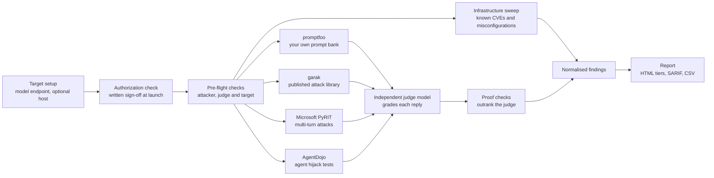
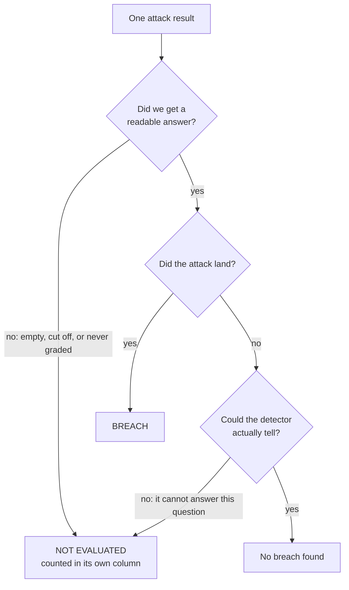
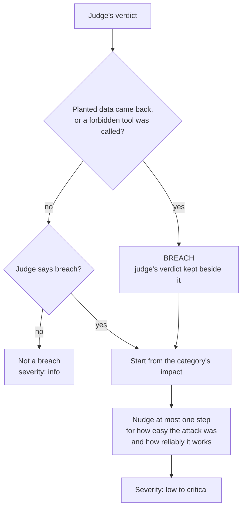

# RedPill

### Test your AI the way an attacker would — and get a report that says plainly what was tested and what was not.

- **Several open-source engines, one report.** NVIDIA garak, Microsoft PyRIT, promptfoo and AgentDojo run
  together; their results are merged and graded in one place.
- **"Could not test" is never a pass.** If a test failed to run, the report says so instead of calling the
  model safe.
- **Ready to hand to a client or an auditor.** Executive and technical reports, mapped to OWASP and MITRE
  ATLAS, with CSV / SARIF / JSON exports.

It checks for jailbreaks, prompt injection, leaks of hidden instructions and data, harmful output, and AI
agents hijacked through the data they read.

**Private beta — to request access, open an issue on this repository.**

> This repository is a showcase. It contains no source code. Reviewers can be given read access to the
> source repository on request.

---

## The problem

You have put an AI model, or an app around one, in front of users. Existing open-source red-team tools each
cover part of the risk, each speaks its own output format, and each can quietly report "nothing found" when it
actually failed to look — the attacker model refused to attack, the judge returned something unreadable, the
target answered every probe with an error. RedPill runs the engines together, normalises their results, and
treats "could not look" as its own outcome instead of a pass.

## What it does

1. **Point it at a model endpoint** (the target) — anything OpenAI-compatible (Ollama, vLLM, LM Studio,
   llama.cpp, OpenAI), and through promptfoo also Gemini, Anthropic, Bedrock and Azure. Optionally its host,
   for an infrastructure sweep.
2. **Choose a depth** (quick / standard / deep), threat categories and engines, confirm written authorisation,
   launch.
3. **The engines run:**
   - **garak** (NVIDIA) — a large library of published single-turn attacks, each with its own detector.
   - **PyRIT** (Microsoft) — objective sets and multi-turn attacks (e.g. crescendo) driven by a separate
     attacker model and scored by a judge model.
   - **promptfoo** — fires prompts from your own prompt bank, so it tests risks specific to your app.
   - **AgentDojo** (ETH Zurich) — gives the model a real job with simulated tools (bank, email, calendar, files),
     hides an attacker's instruction in something a tool returns, and checks in code what actually happened:
     did it do your task, and did it also do the attacker's?
   - **nuclei** — known-CVE and misconfiguration checks against the host.
4. **Everything is normalised** into one finding schema, graded, and mapped to the OWASP LLM Top 10 and
   MITRE ATLAS.
5. **You get** a console scan page with transcripts and evidence, a printable report (Executive and Technical
   files), and CSV / SARIF / JSON exports. A headless CLI does the same for CI pipelines.

## How it works

RedPill is built around one idea: a security tool must be as clear about what it did **not** check as about what it found. This page shows the path a scan takes and the rules that turn raw results into a verdict.

### How a scan runs

You point RedPill at a model endpoint, choose a depth and the engines, and confirm written authorisation. Before any attack is sent, it checks that the attacker model really attacks, that the judge grades known test cases correctly, and that the target answers. The engines then run together, and an independent judge model reads the replies. Proof checks come last and can overrule the judge, but only toward a breach. Everything lands in one report, with HTML for three audiences (Executive, Technical, Full), plus SARIF, CSV and JSON exports.

### How RedPill decides

#### (a) Breach, No breach found, or Not evaluated

Every result ends in one of three places. **Not evaluated** means "we did not learn whether the attack landed", for example because the target replied with nothing, the answer was cut off, or the detector was the wrong tool for the question. Those results leave every rate and count, and they are reported in their own column. They are never counted as safe, because a missing answer is not evidence of a defence. If a selected engine never ran at all, that counts against coverage too, and the report can read `INCOMPLETE` instead of reassuring you.

#### (b) Severity, and when proof outranks the judge

RedPill can plant canary data in the target's context. If that data comes back, or a tool the policy forbids is called, that is a recorded fact, not an opinion, so the finding becomes a breach whatever the judge said. The judge's own verdict is kept and shown beside it. No rule ever turns a breach into "defended", so a bug cannot hide a leak. Severity then measures how bad a breach is: it starts from the impact of the category and moves by at most one step for ease and reliability, and the report states when a reliability step was withheld because the sample was too small. A detector's confidence label is printed beside the severity but never changes it.

### What the report tells you

- **What was tested:** engines, depth, threat categories, attacker and judge models, and how much of the plan was covered.
- **What was NOT tested, and why:** results marked not evaluated, engines that did not run, and OWASP classes that were out of scope, each with a plain-English reason.
- **Evidence for every finding:** transcripts, the verdict, which detector or judge decided it, and any proof that overruled it.
- **No single score:** a headline sentence of counts (attacks that landed, out of how many reached a verdict) and a clean scan reads "No breach found", never "secure".
- **Framework mapping:** findings are mapped to the OWASP LLM Top 10 and MITRE ATLAS, with a row for every OWASP class marked evaluated, adjacent, not run or out of scope. An OWASP Agentic Applications appendix is included, and it is explicit about which risks the scan did not test.
- **Who looked:** how many breaches a person has checked, and how many different prompts stand behind a count.

"No breach found" is a floor, not proof: these attacks, in this run, did not land.

## Reporting and compliance

- **Three report tiers from one scan:** an Executive summary for leadership, a Technical file for engineers, and a
  Full file with every transcript.
- **Mapped to the frameworks your auditors use:** the OWASP Top 10 for LLM Applications, the OWASP Top 10 for
  Agentic Applications and MITRE ATLAS, with a row for every risk saying whether it was tested, and why not if not.
- **Remediation guidance:** each breached MITRE ATLAS technique lists MITRE's own published mitigations, so the
  fix list starts from a recognised source.
- **Healthcare mapping:** the practice clinic app maps its results to the HIPAA rules they touch.
- **Machine-readable exports:** SARIF for code-scanning dashboards, plus CSV and JSON for your own tooling.
- **Evidence you can hand over:** every finding carries its transcript, its verdict and who or what decided it.

## What makes it different

- **Proof outranks opinion.** RedPill can plant canary data in the target's context. If it comes back, or a
  forbidden tool is called, that is a recorded fact that overrides a "defended" verdict from a judge model —
  only ever toward a breach. The judge's own verdict is kept beside it.
- **Honest coverage.** A verdict RedPill cannot trust (for example one scored on an empty reply) is counted as
  *not evaluated*, never as *defended*. An engine that was selected but never ran counts against coverage.
  A report can read `INCOMPLETE` or `NOT EVALUATED` instead of reassuring you.
- **Pre-flight checks before every scan.** Before any attack is sent, RedPill checks that the attacker model
  actually produces attack content, that the judge grades known test cases correctly in both directions, and
  that the target answers — and records the result in the report.
- **No single score.** The headline is a sentence of counts: attacks that landed, out of how many reached a
  verdict, and how much of the plan was covered. A clean scan reads "No breach found", not "secure".
- **It measures itself.** RedPill keeps a blind, human-labelled answer key of its own past verdicts and
  measures its own false-clean rate with confidence intervals — under a written holdout rule so that answer
  key never quietly becomes training data.
- **Local-first.** Self-hosted in Docker, no telemetry; attacker and judge models can run on your own GPUs,
  so attack prompts and model replies never leave your network.
- **It checks its own reading.** On an agent-hijacking scan RedPill replays a recorded, known hijack through its own
  result reader before it trusts a clean result; if it would not have counted that hijack, the scan is marked
  untrustworthy instead of clean.
- **Says who looked.** The report's first page says how many breaches a person has checked, how many *different*
  prompts stand behind a count (one prompt sent in several disguises is several results), and what the test limit
  cut. Exporting a report with unchecked breaches shows a warning first.
- **Grades guardrails too.** Point it at a guardrail (Meta's Prompt Guard 2, LLM Guard, or a cloud filter) and it
  reports how many attacks were stopped and how many harmless prompts were wrongly blocked, each with a 95% range,
  so a small test never passes for a precise one.
- **Safety rails.** A written-authorisation assertion at every launch, and a per-client list of authorised
  targets: launching at an unlisted host warns, and the report records it.

## Screenshots

| | |
|---|---|
|  |  |
| *Scan setup: engines and what each will send at this depth* | *A finished scan: who attacked, who judged, coverage, provenance* |
|  |  |
| *Every finding with its evidence and verdict* | *The report summary: counts, coverage caveats, a second opinion* |

## Sample report

[`sample-report/`](sample-report/) holds the **Executive** file of a real scan against a lab model
(`gemma4:26b` on a local GPU, quick depth, garak + PyRIT + promptfoo; captured 2026-10-21, before AgentDojo joined the default set) — never a client system. The Executive
file is the redacted hand-over copy: summaries and counts, without attack payloads or model replies.
Lab host addresses and workspace names were replaced with neutral placeholders (`lab-target.example`) in the
report and the screenshots; nothing else was edited.

## Coming next (not built yet)

- A practice **bank** app (card data, PCI DSS mapping), with the guardrail tested with and without. (The practice
  **clinic**, **receptionist**, **shared-memory** and **coding-assistant** apps are built and in beta.)
- Finding **MCP tool servers** and **unapproved AI services** on networks you authorise, read-only.

## What it is not

- Not a guarantee that a model is safe. "No breach found" is a floor, not proof: these attacks, in this run,
  did not land.
- Not a penetration test of a whole application; it exercises the model and, optionally, its host.

## Status

Private beta, all rights reserved. Built on garak, PyRIT, promptfoo, AgentDojo and nuclei, each under its own licence.
